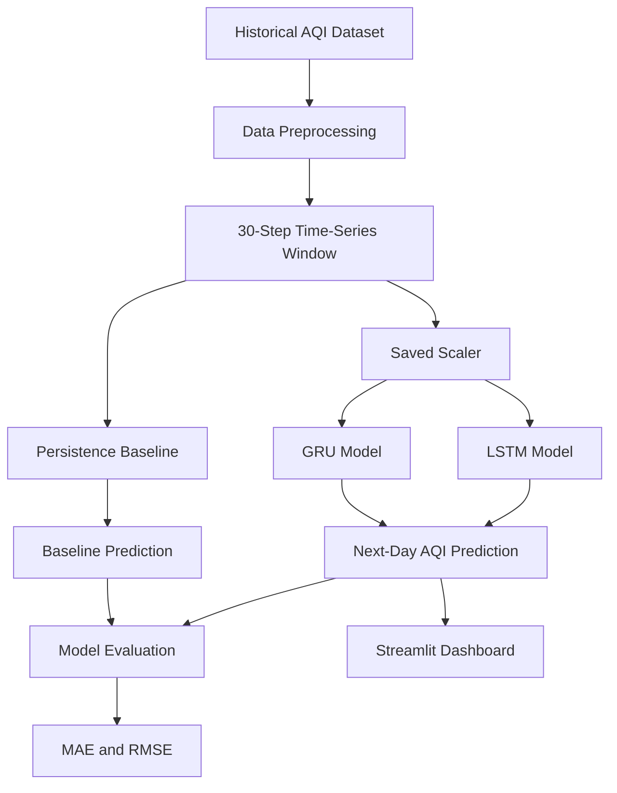

<div align="center">

# 🌍 AirAware
### Air Pollution Early Warning System

**Turning historical air-quality data into actionable next-day AQI forecasts.**

An academic deep learning project exploring time-series forecasting with LSTM and GRU models, evaluated against a simple persistence baseline.

<br/>

[](https://www.python.org/)
[](https://www.tensorflow.org/)
[](https://streamlit.io/)
[](https://pandas.pydata.org/)
[](#-disclaimer)

<br/>

[🚀 Getting Started](#-getting-started) ·
[📊 Model Results](#-model-performance) ·
[🖥️ Dashboard](#️-dashboard) ·
[📄 Report](#-project-report)

</div>

---

## 📌 Table of Contents

- [🌱 About the Project](#-about-the-project)
- [🎯 Objectives](#-objectives)
- [✨ Key Features](#-key-features)
- [🧠 Models and Methodology](#-models-and-methodology)
- [📊 Model Performance](#-model-performance)
- [🏗️ System Architecture](#️-system-architecture)
- [📁 Repository Structure](#-repository-structure)
- [🚀 Getting Started](#-getting-started)
- [🖥️ Dashboard](#️-dashboard)
- [📄 Project Report](#-project-report)
- [🔬 Reproducibility and Limitations](#-reproducibility-and-limitations)
- [🔮 Future Improvements](#-future-improvements)
- [👨‍💻 Author](#-author)
- [⚠️ Disclaimer](#️-disclaimer)

---

## 🌱 About the Project

Air pollution is a major environmental concern, and understanding changes in air quality can help people make more informed decisions.

**AirAware** explores whether deep learning can forecast the next day's Air Quality Index (AQI) using historical observations. The project focuses on Delhi, India, and compares two recurrent neural network architectures—Long Short-Term Memory (LSTM) and Gated Recurrent Unit (GRU)—against a persistence baseline.

The project combines:

- 📈 Historical AQI time-series analysis
- 🧠 Deep learning-based forecasting
- ⚖️ Baseline and model performance comparison
- 🖥️ An interactive Streamlit dashboard
- 📄 Academic documentation and experimental results

> **Project focus:** Evaluate forecasting performance honestly, including cases where a simple baseline performs as well as or better than deep learning models.

## 🎯 Objectives

- Analyze historical air-quality observations for Delhi.
- Prepare sequential data for next-day AQI forecasting.
- Develop and evaluate LSTM and GRU models.
- Compare deep learning predictions against a persistence baseline.
- Build an interactive interface for exploring AQI data and forecasts.
- Document the model results, limitations, and reproducibility considerations.

## ✨ Key Features

<table>
<tr>
<td width="50%">

### 📈 Time-Series Analysis
Explore historical AQI observations and changes over time.

</td>
<td width="50%">

### 🧠 Deep Learning
Use trained LSTM and GRU models for next-day forecasting.

</td>
</tr>
<tr>
<td width="50%">

### ⚖️ Model Comparison
Evaluate models using MAE and RMSE.

</td>
<td width="50%">

### 🖥️ Interactive Dashboard
Upload AQI data and explore supported forecasting features.

</td>
</tr>
<tr>
<td width="50%">

### 📥 Forecast Summary
Download results if the corresponding feature is available in the current app.

</td>
<td width="50%">

### 📄 Research Documentation
Access the notebook, saved model artifacts, and final report.

</td>
</tr>
</table>

## 🧠 Models and Methodology

AirAware uses a **30-time-step lookback window** to predict the next AQI value.

| Model | Description |
|---|---|
| Persistence Baseline | Uses the most recent observed AQI as the next-day prediction |
| LSTM | Learns sequential patterns using Long Short-Term Memory units |
| GRU | Learns sequential patterns using Gated Recurrent Unit layers |

### Forecasting workflow

1. **Data collection:** Load historical Indian air-quality data.
2. **City selection:** Focus on Delhi observations.
3. **Preprocessing:** Prepare the AQI time series and handle unusable observations as required.
4. **Sequence creation:** Build input sequences using a 30-step lookback.
5. **Model inference:** Generate predictions using the saved model and scaler artifacts.
6. **Evaluation:** Compare predictions with actual observations using MAE and RMSE.
7. **Visualization:** Present supported trends, statistics, and forecast information in the dashboard.

### Dataset

The project uses the India Air Quality dataset available on Kaggle.

🔗 **Dataset:** [India Air Quality — Kaggle](https://www.kaggle.com/datasets/rohanrao/air-quality-data-in-india)

The notebook contains the experimental workflow. Refer to it for the exact preprocessing and training implementation.

## 📊 Model Performance

The following metrics are reported in the current final report's dashboard evaluation.

<div align="center">

| Model | MAE ↓ | RMSE ↓ |
|:---|---:|---:|
| Persistence Baseline | **31.46** | 44.97 |
| LSTM | 33.27 | 45.53 |
| GRU | 31.98 | **44.15** |

*Lower MAE and RMSE indicate better performance.*

</div>

### 🔍 What do these results tell us?

<details>
<summary><strong>📌 Persistence Baseline — Lowest MAE</strong></summary>

The persistence baseline has an MAE of **31.46**, the lowest among the three reported models. It therefore has the smallest average absolute prediction error in this evaluation.

This demonstrates why a simple baseline is important when assessing more complex forecasting models.

</details>

<details>
<summary><strong>📌 GRU — Lowest RMSE</strong></summary>

The GRU model has an RMSE of **44.15**, the lowest among the reported models. However, its MAE of 31.98 is higher than the baseline's MAE.

GRU performs best on RMSE in these results, but it does not outperform the baseline on every metric.

</details>

<details>
<summary><strong>📌 LSTM — Further Improvement Needed</strong></summary>

The reported LSTM results are MAE 33.27 and RMSE 45.53. Both metrics are higher than the persistence baseline in this evaluation.

Further experimentation and consistent evaluation would be needed to determine whether LSTM improvements are possible.

</details>

> **Research takeaway:** Deep learning is not automatically better than a simple forecasting baseline. The reported results should be interpreted using both metrics and the evaluation methodology.

**Reproducibility note:** The final report records differences between the current dashboard results and a separate saved experiment. These figures represent the report's dashboard evaluation and must not be assumed to reproduce the notebook experiment automatically. See [Reproducibility and Limitations](#-reproducibility-and-limitations).

## 🏗️ System Architecture



*The diagram illustrates the project's conceptual workflow. Exact implementation details are defined by the notebook and application code.*

## 📁 Repository Structure

```text
AirAware-Air_Pollution_Early_Warning/
│
├── app.py
├── AirAware.ipynb
├── requirements.txt
├── README.md
│
├── reports/
│   └── AirAware_Final_Report_Submission.pdf
│
└── airaware_model/
    ├── lstm_model.keras
    ├── gru_model.keras
    ├── scaler.pkl
    └── metadata.json
```

| File | Purpose |
|---|---|
| `app.py` | Streamlit dashboard |
| `AirAware.ipynb` | Experimental notebook |
| `requirements.txt` | Python dependencies |
| `reports/` | Final academic report |
| `lstm_model.keras` | Saved LSTM model |
| `gru_model.keras` | Saved GRU model |
| `scaler.pkl` | Saved preprocessing scaler |
| `metadata.json` | Experiment and model metadata |

*Ensure the report filename and directory match the files actually committed to GitHub.*

## 🚀 Getting Started

### Prerequisites

- Git
- Python compatible with the project's TensorFlow version
- Pip
- A compatible operating system and environment for the saved model artifacts

<details>
<summary><strong>Step 1 — Clone the repository</strong></summary>

```bash
git clone https://github.com/LEOPRITAM01/AirAware-Air_Pollution_Early_Warning.git
cd AirAware-Air_Pollution_Early_Warning
```

</details>

<details>
<summary><strong>Step 2 — Create a virtual environment</strong></summary>

**Windows**

```bash
python -m venv venv
venv\Scripts\activate
```

**Linux / macOS**

```bash
python3 -m venv venv
source venv/bin/activate
```

</details>

<details>
<summary><strong>Step 3 — Install dependencies</strong></summary>

```bash
python -m pip install --upgrade pip
pip install -r requirements.txt
```

Use a Python version supported by the TensorFlow version specified in your environment. If installation fails, check the compatibility requirements before changing package versions.

</details>

<details>
<summary><strong>Step 4 — Launch AirAware</strong></summary>

```bash
streamlit run app.py
```

Open the local URL printed by Streamlit, usually:

`http://localhost:8501`

</details>

## 🖥️ Dashboard

The Streamlit application provides an interface for working with AQI observations and exploring supported predictions.

### Typical workflow

1. Launch the dashboard.
2. Upload a CSV file containing an `AQI` column if requested by the application.
3. Review the uploaded data and available AQI visualizations.
4. Select a forecasting model if model selection is implemented.
5. Generate and inspect the next-day prediction.
6. Download a forecast summary if the feature is available.

### Dashboard screenshot

Add a real screenshot of the committed dashboard to your repository, for example at `assets/dashboard.png`, and then uncomment the image below:

<!--
<div align="center">
  
  <p><em>AirAware dashboard interface</em></p>
</div>
-->

> **Note:** AirAware uses data provided to the application. It does not fetch live AQI measurements unless a live-data integration is implemented in the code.

## 📄 Project Report

The final academic report documents the project's methodology, evaluation, dashboard, and limitations.

📘 **[Open the AirAware Final Report](reports/AirAware_Final_Report_Submission.pdf)**

The link works after the PDF is committed at the specified path in the repository.

## 🔬 Reproducibility and Limitations

The notebook experiment and dashboard evaluation may differ because of differences in preprocessing, test observations, saved model artifacts, or evaluation procedures. The final report acknowledges this discrepancy.

For reproducible results:

- Use the same dataset and test period.
- Apply the same preprocessing and scaling.
- Evaluate the same saved model versions.
- Use a consistent persistence-baseline definition.
- Calculate MAE and RMSE over identical observations.
- Keep notebook, metadata, dashboard, and report results clearly labelled if they differ.

### Current limitations

- Forecast quality depends on the quality and coverage of historical observations.
- AQI can change due to weather, emissions, and other external factors.
- The current forecasting workflow does not necessarily include weather forecasts or other external variables.
- Predictions may be less reliable for data unlike the training data.
- The system is experimental and is not an official air-quality forecasting service.
- Performance metrics require consistent evaluation before they can be considered reproducible.

## 🔮 Future Improvements

- [ ] Reconcile and reproduce experiment and dashboard metrics.
- [ ] Align model metadata with verified evaluation results.
- [ ] Explore additional forecasting approaches.
- [ ] Incorporate weather and other relevant external variables.
- [ ] Evaluate performance across additional cities and periods.
- [ ] Integrate a verified AQI data source if live monitoring is required.
- [ ] Deploy the dashboard to persistent hosting.
- [ ] Monitor forecast errors as new observations become available.

## 👨‍💻 Author

<div align="center">

### Prabhu Pritam Maharana

B.Tech — Computer Science and Engineering  
Specialization: Data Science and Machine Learning  
Lovely Professional University

**Project:** AirAware — Air Pollution Early Warning System

[View GitHub Repository](https://github.com/LEOPRITAM01/AirAware-Air_Pollution_Early_Warning)

</div>

## ⚠️ Disclaimer

AirAware is an academic and experimental project developed for educational purposes. Predictions and indicative AQI categories are not official measurements, public-health advice, or a substitute for government-issued air-quality forecasts.

For actual air-quality conditions and health guidance, consult official environmental monitoring authorities.

---

<div align="center">

**Built to explore time-series forecasting for cleaner-air awareness. 🌱**

<sub>AirAware · Deep Learning · AQI Forecasting</sub>

</div>
