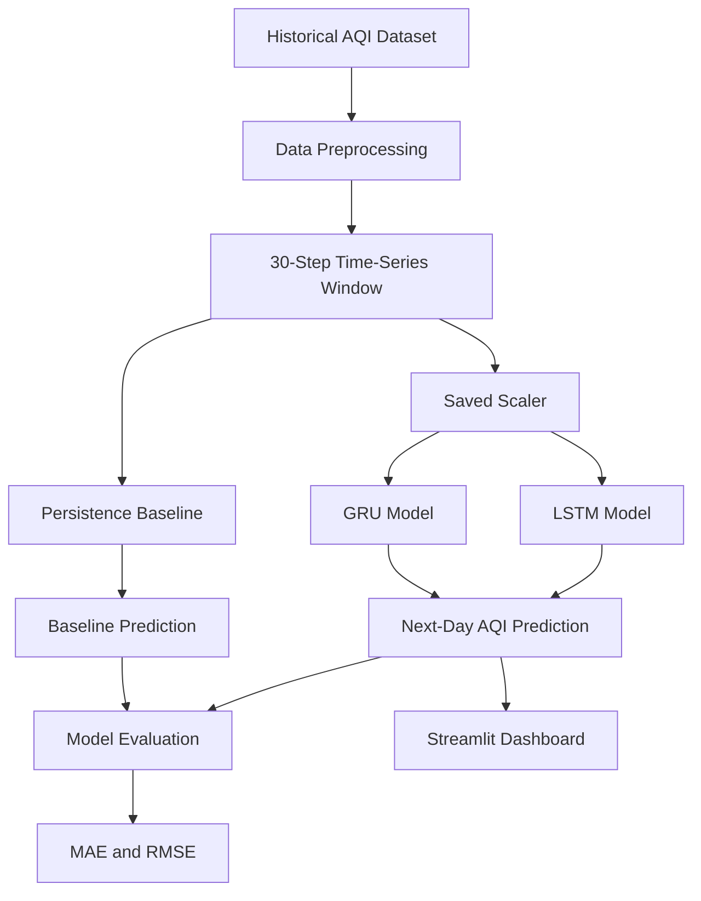

<div align="center">

# 🌍 AirAware
### Air Pollution Early Warning System

**Turning historical air-quality data into next-day AQI forecasts.**

An academic deep learning project using LSTM and GRU models to explore air-quality forecasting, compare prediction performance, and visualize results through an interactive Streamlit dashboard.

<br/>

[](https://www.python.org/)
[](https://www.tensorflow.org/)
[](https://streamlit.io/)
[](https://pandas.pydata.org/)
[](#-disclaimer)

<br/>

[🚀 Getting Started](#-getting-started) ·
[📊 Model Results](#-model-performance) ·
[🖥️ Dashboard](#️-dashboard) ·
[📄 Final Report](#-project-report)

</div>

---

## 📌 Table of Contents

- [🌱 About the Project](#-about-the-project)
- [🎯 Objectives](#-objectives)
- [✨ Key Features](#-key-features)
- [🧠 Models and Methodology](#-models-and-methodology)
- [📊 Model Performance](#-model-performance)
- [🏗️ System Architecture](#️-system-architecture)
- [📁 Repository Structure](#-repository-structure)
- [🚀 Getting Started](#-getting-started)
- [🖥️ Dashboard](#️-dashboard)
- [📄 Project Report](#-project-report)
- [🔬 Reproducibility and Limitations](#-reproducibility-and-limitations)
- [🔮 Future Improvements](#-future-improvements)
- [👨‍💻 Author](#-author)
- [⚠️ Disclaimer](#️-disclaimer)

---

## 🌱 About the Project

Air pollution is a major environmental concern. Understanding how air quality changes over time can help people make more informed decisions.

**AirAware** explores whether deep learning can predict the next day's Air Quality Index (AQI) using historical observations. The project focuses on Delhi, India, and compares two recurrent neural network architectures—Long Short-Term Memory (LSTM) and Gated Recurrent Unit (GRU)—against a persistence baseline.

### At a glance

| Component | Details |
|---|---|
| Project domain | Deep Learning and Time-Series Forecasting |
| Study location | Delhi, India |
| Forecast horizon | Next day |
| Lookback window | 30 time steps |
| Deep learning models | LSTM and GRU |
| Baseline | Persistence Baseline |
| Dashboard | Streamlit |
| Evaluation metrics | MAE and RMSE |

## 🎯 Objectives

- Analyze historical AQI observations for Delhi.
- Prepare sequential data for next-day forecasting.
- Develop and evaluate LSTM and GRU models.
- Compare deep learning models against a persistence baseline.
- Build an interactive interface for exploring AQI data and forecasts.
- Document results, limitations, and reproducibility considerations.

## ✨ Key Features

<table>
<tr>
<td width="50%">

### 📈 AQI Analysis

Explore historical AQI observations and trends.

</td>
<td width="50%">

### 🧠 Deep Learning

Use saved LSTM and GRU models for forecasting.

</td>
</tr>
<tr>
<td width="50%">

### ⚖️ Model Evaluation

Compare predictions using MAE and RMSE.

</td>
<td width="50%">

### 🖥️ Interactive Dashboard

Upload AQI data and explore supported forecasting features.

</td>
</tr>
<tr>
<td width="50%">

### 📥 Forecast Summary

Download forecast results if supported by the current app.

</td>
<td width="50%">

### 📄 Academic Report

Review the project methodology, findings, and limitations.

</td>
</tr>
</table>

## 🧠 Models and Methodology

AirAware uses a **30-time-step lookback window** to predict the next AQI value.

| Model | Description |
|---|---|
| Persistence Baseline | Uses the latest observed AQI as the next-day prediction |
| LSTM | Learns sequential patterns using Long Short-Term Memory units |
| GRU | Learns sequential patterns using Gated Recurrent Unit layers |

### Forecasting workflow

1. **Data collection:** Load historical Indian air-quality data.
2. **City selection:** Focus on Delhi observations.
3. **Preprocessing:** Prepare the AQI time series and handle unusable observations as required.
4. **Sequence creation:** Create input sequences with a 30-step lookback.
5. **Model inference:** Generate predictions using saved models and preprocessing artifacts.
6. **Evaluation:** Compare predictions with actual observations using MAE and RMSE.
7. **Visualization:** Present supported AQI trends, statistics, and forecasts in the dashboard.

### Dataset

The project uses the India Air Quality dataset available on Kaggle.

🔗 **[India Air Quality Dataset — Kaggle](https://www.kaggle.com/datasets/rohanrao/air-quality-data-in-india)**

Refer to `AirAware.ipynb` for the experimental workflow and implementation details.

## 📊 Model Performance

The following results are reported in the final report's dashboard evaluation.

<div align="center">

| Model | MAE ↓ | RMSE ↓ |
|:---|---:|---:|
| Persistence Baseline | **31.46** | 44.97 |
| LSTM | 33.27 | 45.53 |
| GRU | 31.98 | **44.15** |

<sub>Lower values indicate better performance.</sub>

</div>

### 🔍 Understanding the results

<details>
<summary><strong>📌 Persistence Baseline — Lowest MAE</strong></summary>

The persistence baseline has an MAE of **31.46**, the lowest among the three reported models. It has the smallest average absolute prediction error in this evaluation.

This highlights the importance of comparing deep learning approaches with simple baselines.

</details>

<details>
<summary><strong>📌 GRU — Lowest RMSE</strong></summary>

The GRU model has an RMSE of **44.15**, the lowest among the reported models. Its MAE of 31.98 is nevertheless higher than the baseline's MAE.

GRU performs best on RMSE in these results, but it does not outperform the baseline on every metric.

</details>

<details>
<summary><strong>📌 LSTM — Performance Observation</strong></summary>

The reported LSTM results are MAE 33.27 and RMSE 45.53. Both values are higher than the persistence baseline's corresponding metrics.

Further experimentation would be needed to determine whether the LSTM model can be improved.

</details>

> **Key finding:** A more complex model is not automatically a better model. Performance should be assessed using consistent evaluation data and appropriate baseline comparisons.

**Reproducibility note:** The final report documents a difference between the dashboard results and a separate saved experiment. The table above reflects the dashboard values reported in the final report; these should not be assumed to reproduce the notebook experiment automatically.

## 🏗️ System Architecture



*This diagram illustrates the conceptual workflow. The actual implementation is defined by the notebook and application code.*

## 📁 Repository Structure

```text
AirAware-Air_Pollution_Early_Warning/
│
├── app.py
├── AirAware.ipynb
├── requirements.txt
├── README.md
│
├── assets/
│   └── Screenshot 2026-10-25 172906.png
│
├── reports/
│   └── AirAware_Final_Report_Submission.pdf
│
└── airaware_model/
    ├── lstm_model.keras
    ├── gru_model.keras
    ├── scaler.pkl
    └── metadata.json
```

| File or Folder | Purpose |
|---|---|
| `app.py` | Streamlit dashboard |
| `AirAware.ipynb` | Experimental notebook |
| `requirements.txt` | Python dependencies |
| `assets/` | Dashboard screenshots and visual assets |
| `reports/` | Final academic report |
| `lstm_model.keras` | Saved LSTM model |
| `gru_model.keras` | Saved GRU model |
| `scaler.pkl` | Saved preprocessing scaler |
| `metadata.json` | Model and experiment metadata |

## 🚀 Getting Started

### Prerequisites

- Git
- Python compatible with your installed TensorFlow version
- Pip
- A compatible environment for the saved model artifacts

<details>
<summary><strong>Step 1 — Clone the repository</strong></summary>

```bash
git clone https://github.com/LEOPRITAM01/AirAware-Air_Pollution_Early_Warning.git
cd AirAware-Air_Pollution_Early_Warning
```

</details>

<details>
<summary><strong>Step 2 — Create a virtual environment</strong></summary>

**Windows**

```bash
python -m venv venv
venv\Scripts\activate
```

**Linux / macOS**

```bash
python3 -m venv venv
source venv/bin/activate
```

</details>

<details>
<summary><strong>Step 3 — Install dependencies</strong></summary>

```bash
python -m pip install --upgrade pip
pip install -r requirements.txt
```

Use a Python version supported by the TensorFlow version in your environment. Check compatibility before changing package versions.

</details>

<details>
<summary><strong>Step 4 — Launch the dashboard</strong></summary>

```bash
streamlit run app.py
```

Open the local URL displayed by Streamlit, usually:

`http://localhost:8501`

</details>

## 🖥️ Dashboard

AirAware provides a Streamlit interface for exploring AQI data and examining supported next-day forecasts.

### Dashboard preview

<div align="center">
  
  <p><em>AirAware dashboard interface</em></p>
</div>

### How to use the dashboard

1. Start the application.
2. Upload a CSV file containing an `AQI` column if requested by the app.
3. Review the available data validation and AQI visualizations.
4. Select a model if model selection is implemented.
5. Generate and inspect the next-day prediction.
6. Download a forecast summary if that feature is available.

Ensure the uploaded observations are chronologically ordered and match the input format expected by `app.py`.

> **Data note:** The dashboard uses the data supplied to it. It does not automatically fetch live AQI measurements unless live-data integration is implemented in the application.

## 📄 Project Report

The final academic report documents the project's methodology, results, dashboard, and limitations.

📘 **[Read the AirAware Final Report](reports/AirAware_Final_Report_Submission.pdf)**

The link will work when the PDF is committed at that path in the repository.

## 🔬 Reproducibility and Limitations

The notebook experiment and dashboard evaluation may differ because of differences in preprocessing, test observations, saved model artifacts, or evaluation procedures. The final report acknowledges this discrepancy.

For reproducible results:

- Use the same dataset and test period.
- Apply the same preprocessing and scaling procedure.
- Evaluate the same saved model versions.
- Use a consistent persistence-baseline definition.
- Calculate MAE and RMSE over identical observations.
- Clearly label results when the notebook, metadata, dashboard, and report differ.

### Current limitations

- Forecast quality depends on historical data quality and coverage.
- AQI can change due to weather, emissions, and other external factors.
- The forecasting workflow does not necessarily include weather forecasts or other external variables.
- Predictions may be less reliable when uploaded data differs from the training data.
- The system is experimental and is not an official forecasting service.
- Performance results require consistent evaluation before they can be considered reproducible.

## 🔮 Future Improvements

- [ ] Reproduce and reconcile experiment and dashboard metrics.
- [ ] Align model metadata with verified evaluation results.
- [ ] Explore additional forecasting approaches.
- [ ] Incorporate weather and other relevant external variables.
- [ ] Evaluate performance across additional cities and time periods.
- [ ] Integrate a verified AQI data source if live monitoring is required.
- [ ] Deploy the dashboard to persistent hosting.
- [ ] Monitor forecast errors as new observations become available.

## 👨‍💻 Author

<div align="center">

### Prabhu Pritam Maharana

B.Tech — Computer Science and Engineering  
Specialization: Data Science and Machine Learning  
Lovely Professional University

[🌐 View GitHub Repository](https://github.com/LEOPRITAM01/AirAware-Air_Pollution_Early_Warning)

</div>

## ⚠️ Disclaimer

AirAware is an academic and experimental project developed for educational purposes. Its predictions and indicative AQI categories are not official measurements, public-health advice, or a substitute for government-issued air-quality forecasts.

For actual air-quality conditions and health guidance, consult official environmental monitoring authorities.

---

<div align="center">

**Built to explore time-series forecasting for cleaner-air awareness. 🌱**

<sub>AirAware · Deep Learning · AQI Forecasting</sub>

</div>
